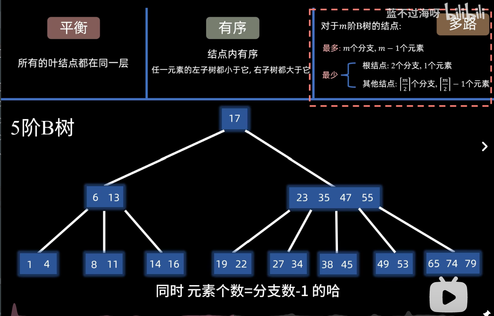
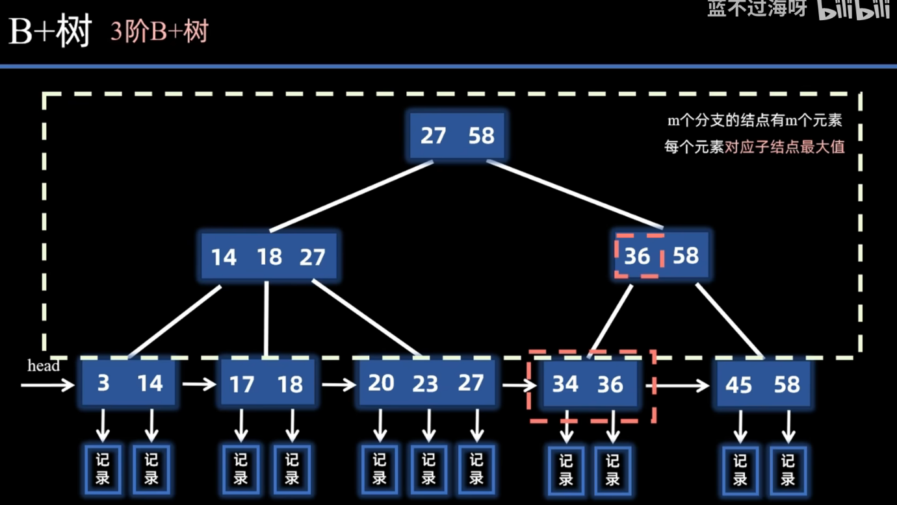

## 课外补充学习

### 数据库部分

关于树相关部分，AVL树就是（高度平衡树），红黑树（弱平衡树，插入删除开销低，读写可混合）

B树

B+树（优点是扇出更大，树更矮，i/o读写更快，范围查询和排序更快，查询更稳定）这个就是数据库的索引结构

聚簇索引：把数据存在叶子节点，找到的就是数据本身

二级索引：叶子节点就只有索引值和主键值，后续要找数据本身得再通过主键值去主键树上面再找

vs：InnoDB 主键索引叶子节点直接存行数据；二级索引叶子节点存的是主键值，拿到主键后回主键树再查一次，就是**回表**

聚簇索引（主键 id）
┌──────────────────────────┐
│ [1 | 张三 | 25 | 北京]     │  ← 整行在这
│ [2 | 李四 | 30 | 上海]     │
│ [3 | 王五 | 28 | 北京]     │
└──────────────────────────┘
▲
│ 回表：拿 id 回来查整行
│
二级索引 idx_city
┌──────────────────────────┐
│ [北京 | id=1]             │  ← 只有 city + 主键
│ [北京 | id=3]             │
│ [上海 | id=2]             │
└──────────────────────────┘

快照读：普通 `SELECT`，走 MVCC，读的是 ReadView 判定可见的历史版本，不加锁。

当前读：`SELECT ... FOR UPDATE`、`UPDATE`、`DELETE`，读最新数据并加锁。

666，覆盖索引原来这么好理解我只需要：让 `WHERE`、`ORDER BY`、`SELECT` 涉及的列全部落在一个联合索引里，同时让排序在索引里天然有序，避免 filesort。

e.g：

ALTER TABLE orders                          -- 修改 orders 表
ADD INDEX idx_user_status_time_amount       -- 新增一个索引，索引名叫 idx_user_status_time_amount
(user_id, status, created_at, amount);    -- 这个索引按这 4 列的顺序建立

SELECT id, amount, created_at
FROM orders
WHERE user_id = 10086 AND status = 1
ORDER BY created_at DESC
LIMIT 20;

大概就补这么多

---

如果自己创建一个数据库：

user

id，账号，密码，名字，头像，标签，留言，权限，创建时间，更新时间

question

id,名字，内容，标签，创建时间，更新时间，由谁创建（user.id），//属于什么题库（question_bank.名字）

question_bank

id,名字，标签，创建时间，更新时间，由谁创建（user.id），//有哪些题目（question.名字）

已经理解，打包成字段，一对多，多对多

user

id，账号，密码，名字，头像，标签，留言，权限，创建时间，更新时间

question_bank

id,名字，标签，创建时间，更新时间，由谁创建（user.id）

question

id,名字，内容，标签，创建时间，更新时间，由谁创建（user.id）

question_bank_question

id，question_bank.id,question.id

ai优化的

-- 1. 用户表
user (
id,
userAccount (账号),
userPassword (密码),
userName (名字),
userAvatar (头像),
userProfile (标签/简介),
userRole (权限),
isDelete (是否删除),
createTime (创建时间),
updateTime (更新时间)
)

-- 2. 题库表
question_bank (
id,
title (名字),
tags (标签),
isDelete,
createTime,
updateTime,
userId (由谁创建)
)

-- 3. 题目表
question (
id,
title (名字),
content (内容),
tags (标签),
isDelete,
createTime,
updateTime,
userId (由谁创建)
)

-- 4. 题库题目关联表（中间表）
question_bank_question (
id,
questionBankId,
questionId,
createTime
-- 注意：没有 isDelete，且 (questionBankId, questionId) 必须建联合唯一索引
)

ok

##### //todo 是接手一个项目自己的先看的，里面是一些代码需要自己调整的地方，可以按自己的要求改动

学完了，querywrapper直接new Querywrapper<>().方法

GetMapping()

public 返回值类型 名字 （这里要你获得的参数）{
}
